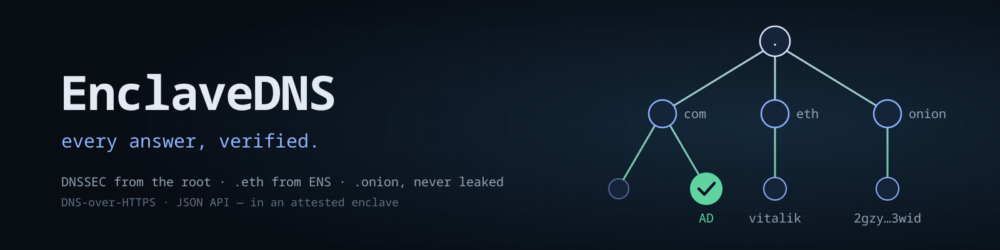

# EnclaveDNS



A DNS server that runs in an attested enclave. It validates every answer with
DNSSEC from the root keys down, and serves your own zones with online DNSSEC
signing. It resolves `.eth` names from the Ethereum Name Service and `.onion`
addresses itself, and never asks the public DNS about either. Queries arrive
over plain DNS (UDP and TCP 53), DNS-over-TLS and DNS-over-HTTPS. TLS for
DNS-over-TLS and DNS-over-HTTPS ends inside the enclave, and the server keeps
counters only, never a query log.

It is one `wasm32-wasip2` **service app**. The DNS wire format, the iterative
resolver, the validator, the signer, the ENS client and the HTTP server are
hand-written Rust. The dependencies are the cryptographic primitives (RSA,
ECDSA, Ed25519, SHA-1/2/3, Keccak) and the pure-Rust TLS stack. It runs on
wstd's `wasi:io/poll` reactor, so a slow authoritative server stalls only the
one query that is waiting on it.

## What it does

| | |
| --- | --- |
| Recursion | Iterative from the root hints, with QNAME minimisation (RFC 9156). UDP first; falls back to TCP on truncation, or for good when UDP is unavailable. It can instead forward to `udp://`, `tcp://`, `tls://` or `https://` upstreams while still validating locally (it asks with CD set and checks everything itself). |
| DNSSEC validation | Chain of trust from the root KSK-2017 and KSK-2024 anchors. Algorithms 5, 7, 8, 10 (RSA), 13, 14 (ECDSA) and 15 (Ed25519); DS digests 1, 2, 4. NSEC and NSEC3 denial (NXDOMAIN, NODATA, empty non-terminals, wildcards, opt-out), and compact denial (RFC 9824), which it turns back into NXDOMAIN. Unsupported algorithms count as insecure (RFC 4035 §5.2); NSEC3 above 100 iterations counts as insecure (RFC 9276). |
| Answers | Bogus data gets SERVFAIL with an Extended DNS Error (RFC 8914) saying why, for example `EDE 9: no dnssec-failed.org. DNSKEY matches its DS`. AD is set only on data it validated. CD=1 returns the data unvalidated. RRSIGs and NSEC records go to clients that set DO, so a downstream validator such as `delv` can check the answers again itself. |
| Hosted zones | Authoritative zones from the config, signed online with one ECDSA P-256 key per zone. The key is derived from a secret, so the DS survives restarts. Compact denial (RFC 9824) makes zone walking impossible. CDS/CDNSKEY are published (RFC 7344/8078). Delegations with glue, wildcards and empty non-terminals are handled. |
| `.eth` | ENS: registry and resolver calls must agree across a quorum of independent RPC providers. Also supports ENSIP-10 wildcard resolvers, CCIP-Read offchain resolvers (EIP-3668) and DNS records stored in ENS. The contenthash is served as DNSLink. `<name>.ens` is accepted as another spelling of `<name>.eth`. |
| `.onion` | Answered locally and never sent anywhere (RFC 7686). v3 addresses are checked fully (base32, checksum, version, Ed25519 point). The service key comes back in TXT, and A/AAAA point at an onion gateway if you configure one. |
| Transports | UDP/53 and TCP/53 on the deployment's dedicated IPv6. DNS-over-TLS on 853 and DNS-over-HTTPS (RFC 8484, GET and POST) on the app's own hostname, with response padding (RFC 8467). A JSON API in the Google/Cloudflare shape. |
| Abuse limits | Per-client UDP response rate limiting: over the limit, every other reply is an empty truncated one (RRL "slip"), so a spoofed victim gets nothing amplified while a real client retries over TCP. ANY gets a minimal answer (RFC 8482), and AXFR is refused. |

## Using it

Once deployed, the status page at `https://<label>.app.enclave.host/` lists
the exact endpoints:

- **DNS-over-HTTPS**: `https://<label>.app.enclave.host/dns-query`. In Firefox
  use *Settings → Privacy → DNS over HTTPS → Custom*; in Chrome use *Use secure
  DNS → Custom*. With curl, pass `--doh-url`.
- **DNS-over-TLS**: host `<label>.app.enclave.host`, port 853. On Android,
  enter the host name in *Private DNS*. `kdig +tls`, stubby and
  systemd-resolved (`DNSOverTLS=yes`) also work.
- **Plain DNS**: `<label>.ip.enclave.host` resolves to the deployment's own
  IPv6 address, on port 53 over UDP and TCP:
  `dig @<that address> isc.org +dnssec`.
- **JSON**: `curl 'https://<label>.app.enclave.host/resolve?name=vitalik.eth&type=TXT'`.
  Add `do=1` for DNSSEC records and `cd=1` to skip validation. The answer
  includes `Security` (`secure`/`insecure`/`bogus`), the `EDE`, and which
  sources answered.
- **IPFS**: point Kubo's `DNS.Resolvers` for `eth.` at the DoH URL and
  `/ipns/vitalik.eth` resolves through ENS via DNSLink.

## What `.eth` answers

| Query | Answer |
| --- | --- |
| any type the name's resolver stores as DNS records (ENS `dnsRecord`) | exactly those records |
| `TXT <name>.eth` | `dnslink=/ipfs/…` (or `/ipns/…`) from the contenthash, and `eth=0x…` from the address |
| `TXT _dnslink.<name>.eth` | the DNSLink record IPFS clients ask for |
| `A`/`AAAA` with no stored records | a CNAME to `<address>.onion` if the contenthash is an onion service; else to `<name>.eth.<gateway>` if `ens.gateway` is set (for example `eth.limo`); else no data |
| a name with no ENS resolver | NXDOMAIN |

To open `.eth` sites in an ordinary browser, through your own IPFS, Swarm,
Arweave and Tor software and over HTTPS, see [EnclaveDNS Local](local/README.md).

`GET /api/ens/<name>` shows the whole picture: the resolver, whether it was
reached by wildcard, the address, the contenthash, and the common text records.

**Trust.** ENS data is not DNSSEC-signed, so `.eth` answers never carry AD.
What protects them: every `eth_call` runs against several RPC providers at once
and is accepted only when `quorum` of them return identical bytes. The calls
are pinned to one block (the quorum's head minus two), so honest providers see
the same state. CCIP-Read answers are accepted only through the resolver
contract's own callback, which is itself a quorum `eth_call`. A provider can
withhold an answer, but cannot forge one unless `quorum` providers collude.

## What `.onion` answers

A v3 onion address is its service's Ed25519 public key. The address must
decode, carry the right SHA3-256 checksum and version 3, and name a usable
curve point; otherwise the answer is NXDOMAIN with `EDE 24` and the reason (a
typo fails the checksum). Subdomains such as `www.<address>.onion` name the
same service. For a valid address:

- `TXT` gives `"v=onion3" "key=ed25519:<base64>"`, the service identity.
- `A`/`AAAA` give the onion gateway configured under `onion`. That can be the
  addresses of a Tor transparent proxy you run (`onion.a`, `onion.aaaa`), or a
  CNAME to `<address>.onion.<suffix>` for a gateway that serves names that way
  (`onion.cname_suffix`). With no gateway configured, a valid address answers
  no data.

Reaching an onion service still takes Tor. EnclaveDNS validates the name and
says where your gateway is; it does not carry the traffic. The name never
leaves the enclave either way. A public name that CNAMEs into `.onion` is
handled the same way, because CNAME chains are followed hop by hop and each
hop goes to whichever source owns it.

## Hosted zones

```json
"zones": [{
  "name": "example.org",
  "records": [
    "@ NS ns1",
    "ns1 A 203.0.113.53",
    "@ A 203.0.113.10",
    "www CNAME @",
    "@ MX 10 mail.example.net.",
    "@ TXT \"v=spf1 -all\"",
    "@ CAA 0 issue \"letsencrypt.org\"",
    "_sip._tcp SRV 0 5 5060 sip",
    "*.preview A 203.0.113.20",
    "@ HTTPS 1 . alpn=h2,h3"
  ]
}]
```

Each record is one zone-file line: owner (`@`, relative, or absolute with a
trailing dot), optional TTL (`3600`, `1h`) and class, type, data. Supported
types: A, AAAA, NS, CNAME, DNAME, PTR, MX, TXT, SRV, SOA, CAA, DS, TLSA,
SSHFP, OPENPGPKEY, URI, HTTPS/SVCB, HINFO, and any other type in the RFC 3597
form (`TYPE999 \# 2 abcd`). A missing SOA is generated. DNSKEY, RRSIG, NSEC,
CDS and CDNSKEY are generated by the server, not written. `"dnssec": false`
serves a zone unsigned.

To make a zone secure, publish its DS record at the registrar. The DS is shown
on the status page, in `GET /api/zones` and in the start-up log. The signing
key comes from the `ENCLAVEDNS_ZONE_SEED` secret, so it stays the same across
restarts and moves. Without that secret, each start makes a new key, the
status page says so in amber, and a published DS would break the zone.

For the zone to be reachable from the internet, its parent must delegate it
to this server. The server's address is the deployment's IPv6 (the AAAA of
`<label>.ip.enclave.host`); give your NS name that address as glue.

## Privacy

- No query names and no client addresses are written anywhere: not to logs,
  not to the status API. The counters are totals.
- QNAME minimisation means the root and TLD servers see only the labels they
  need.
- Authoritative servers see queries come from the enclave host's address, not
  the client's.
- **ENS lookups do reveal names to RPC providers**: an `eth_call` carries the
  namehash, which is easy to reverse for known names, and CCIP gateways see
  the name itself. This is inherent to reading ENS through public RPCs. Point
  `ens.rpc` at providers you trust, or your own node.
- UDP/53 and TCP/53 are plaintext on the wire as they always are; the relay
  that carries them could read them. DNS-over-TLS and DNS-over-HTTPS are
  encrypted to the enclave itself.

## Configuration

`ENCLAVE_CONFIG` (JSON; the platform also delivers it as the file named by
`ENCLAVE_CONFIG_FILE`, which is read first). A value written `$NAME` is a
deployment secret: the platform substitutes it before the app starts, and a
reference left unsubstituted is read from the environment.
[`assets/deploy-config.template.json`](assets/deploy-config.template.json) is
a starting point.

| Key | Default | |
| --- | --- | --- |
| `recursion` | `true` | `false` makes it authoritative-only: names outside the hosted zones, `.eth` and `.onion` get REFUSED |
| `resolver.forward` | `[]` (the published config: Cloudflare and Quad9 DoH) | upstreams instead of iterating: `udp://9.9.9.9`, `tcp://…`, `tls://1.1.1.1#cloudflare-dns.com`, `https://<ip>/dns-query`. Answers are still validated here |
| `resolver.validate` | `true` | DNSSEC validation |
| `resolver.qname_minimisation` | `true` | RFC 9156 |
| `resolver.transport` | `auto` | `auto`: UDP until the host refuses it, then TCP; `udp`; `tcp` |
| `resolver.ipv4`, `resolver.ipv6` | `true` | which authoritative server addresses to use |
| `resolver.cache_entries` | `50000`, or less on a small guest | answers kept |
| `resolver.max_ttl`, `resolver.max_negative_ttl` | `86400`, `3600` | caps on cached TTLs |
| `zones` | `[]` | see *Hosted zones*; each has `name`, `records`, optional `ttl` (default 3600) and `dnssec` (default true) |
| `zone_key_seed` | `$ENCLAVEDNS_ZONE_SEED` env | at least 32 characters; derives every zone's signing key |
| `ens.enabled` | `true` | |
| `ens.rpc` | publicnode, drpc, flashbots | `https://` Ethereum JSON-RPC endpoints (may be `$SECRET` URLs with keys in them) |
| `ens.quorum` | `2` | how many must return identical results |
| `ens.ttl` | `300` | TTL of `.eth` answers |
| `ens.gateway` | none | e.g. `eth.limo`: A/AAAA for names with a contenthash CNAME to `<name>.eth.limo` |
| `ens.alias_ens_tld` | `true` | answer `<name>.ens` with a CNAME to `<name>.eth` |
| `onion.enabled` | `true` | `false` = every `.onion` name is NXDOMAIN, still never sent out |
| `onion.a`, `onion.aaaa` | `[]` | gateway addresses for valid onion names |
| `onion.cname_suffix` | none | or: CNAME `<address>.onion` to `<address>.onion.<suffix>` |
| `onion.ttl` | `300` | |
| `rate_limit.udp_per_second`, `rate_limit.udp_burst` | `40`, `80` | per UDP client |
| `admin_token` | `$ENCLAVEDNS_ADMIN_TOKEN` env | enables `POST /api/flush[?name=…]` with `X-Api-Key` |
| `listen` | | local runs only: `{"dns": 5300, "dot": 8530, "http": 8000, "bind": "127.0.0.1"}`; `null` turns a listener off. On the platform, `ENCLAVE_PORTS` decides |

## HTTP endpoints

| | |
| --- | --- |
| `GET /` | the status page: endpoints, a lookup tool (`/#name/TYPE` links to a lookup), live counters, hosted zones with their DS |
| `GET/POST /dns-query` | DNS-over-HTTPS (RFC 8484); with `name=` instead of `dns=`, the JSON API |
| `GET /resolve?name=&type=&do=&cd=` | JSON API |
| `GET /api/status` | counters, resolver mode, trust anchors, ENS and onion settings, zones |
| `GET /api/zones` | every hosted record, DS and DNSKEY |
| `GET /api/ens/<name>` | an ENS name's resolver, address, contenthash and text records |
| `GET /api/onion/<name>` | whether an onion address is valid, and its key |
| `POST /api/flush` | empty the cache (or `?name=` and everything under it); needs `X-Api-Key` |

## Platform notes

Today's hosts run every app in its own isolated domain (an SNP guest, an
Android pVM, or a Hyper-V partition on Enclave Shield). That shapes what
EnclaveDNS can offer there:

- **DNS-over-HTTPS only, on isolated hosts.** An isolated app's declared
  TCP/UDP ports are never exposed as public plaintext ports: by design they
  are reachable only through an attested TLS tunnel and a local connector
  (`isolation/m4/PROTECTED-PORTS.md` in the platform repo), which ordinary DNS
  clients cannot use. So the catalog's 0.1.1 declares `http:8000` alone:
  DoH, the JSON API and the status page. Plain DNS on UDP/TCP 53 and
  DNS-over-TLS need a host that offers public raw ports (0.1.0 declares them).
- **No raw outbound network.** An isolated domain reaches only the HTTPS
  origins named in its config, through forwarders the platform sets up before
  the app starts. So the default config forwards to DoH upstreams
  (`resolver.forward`) instead of iterating from the root. DNSSEC is still
  validated inside the app: it asks with CD set and checks every chain from
  the root anchors itself, so a dishonest upstream can withhold answers but
  not forge them. Outbound hosts are found through the platform's own name
  lookup, which inside a domain is the only one that names those forwarders.
- **Every upstream round trip is slow there**, because egress leaves through
  the host and a network exit: on the first Enclave Shield host one DoH
  exchange took about as long as a whole cold lookup on a workstation, and a
  new TLS connection several times that. So since 0.1.3:
  - upstreams speak HTTP/2 when they offer it, with one multiplexed
    connection per origin, pinged while in use. A burst of new names shares
    it instead of dialling a connection each;
  - the DS and DNSKEY sets of the top three zones above a new name are asked
    for at once, rather than one zone after another as the chain walk reaches
    them, and identical upstream questions in flight are asked only once;
  - a slow upstream is hedged: the next one is asked too after twice its
    smoothed round trip;
  - a name asked in the last tenth of its TTL is refreshed in the background,
    and for an hour past its TTL an expired answer is served at once (TTL 30,
    RFC 8767) while it refreshes. A failed refresh keeps the old answer.

  `GET /api/status` shows each upstream's smoothed round trip, the HTTP/2 and
  HTTP/1.1 connection counts and the time of the last new connection.
- **ENS offchain resolvers (CCIP-Read) fail on isolated hosts.** Their gateway
  URLs come from the contracts at lookup time, so they are not among the
  config's allowed origins. On-chain ENS names resolve normally.
- **Ports below 443.** A Hyper-V partition that holds secrets lowers the
  unprivileged port floor to 443, so a command app cannot bind 53 there
  (0.1.0's first deployment on Enclave Shield died exactly so). Every
  listener's bind result is on `GET /api/status` (`startup`), because an
  isolated host withholds the app's stderr; a listener that cannot bind no
  longer stops the others.
- **Where raw ports exist** (a shared, non-isolated runtime), deploy without
  transparent egress: under `-S egress`, wasmtime refuses every UDP send from
  the guest, replies included. The app says so on its status page
  (`UDP replies: blocked`); TCP/53, DNS-over-TLS and DNS-over-HTTPS keep
  working, and its own upstream queries switch to TCP by themselves. The UDP
  relay gives every client address its own flow, which is what makes
  per-client rate limiting possible without seeing client addresses.
- **Hosted zones need two secrets** (`ENCLAVEDNS_ZONE_SEED`, and
  `ENCLAVEDNS_ADMIN_TOKEN` for `/api/flush`). The default config names
  neither, so a deployment needs no secrets; to host zones, deploy with a
  config override that adds `zones`, `"zone_key_seed": "$ENCLAVEDNS_ZONE_SEED"`
  and `"admin_token": "$ENCLAVEDNS_ADMIN_TOKEN"`, and stage the secrets.

## Build and test

```sh
rustup target add wasm32-wasip2
cargo build --release --target wasm32-wasip2
# -> target/wasm32-wasip2/release/enclavedns.wasm (~2.5 MB)

cargo test --target wasm32-wasip2      # 35 unit tests, run under wasmtime
```

The unit tests include the RFC 4034 key-tag and DS examples, the RFC 5155
NSEC3 hash and proof vectors, the RFC 4035 NSEC proofs, the EIP-137 namehash
and EIP-55 vectors, and the Tor Project's real onion address.

Run it locally exactly as the platform does, with local ports:

```sh
cat > dev.json <<'JSON'
{"zone_key_seed": "a-local-seed-of-at-least-32-characters",
 "zones": [{"name": "enclavedns.test", "records": ["@ NS ns1", "ns1 A 192.0.2.53", "www A 192.0.2.10"]}],
 "listen": {"dns": 5300, "dot": 8530, "http": 8000}}
JSON
wasmtime run -Scli -Stcp -Sudp -Sinherit-network -Sallow-ip-name-lookup \
  --dir .::. --env ENCLAVEDNS_CONFIG=dev.json target/wasm32-wasip2/release/enclavedns.wasm

dig @127.0.0.1 -p 5300 isc.org +dnssec           # flags: ... ad
delv @127.0.0.1 -p 5300 www.isc.org               # ; fully validated
tests/live.sh                                     # 22 end-to-end checks with dig, delv, curl
```

`enclavedns.wasm lookup <name> [type] ...` resolves names once, prints the
result and exits; it is useful for debugging a config.

## Publish and deploy

1. **Secrets** (only to host zones). `scripts/new-secrets.sh enclavedns-secrets.env` writes
   `ENCLAVEDNS_ZONE_SEED` and `ENCLAVEDNS_ADMIN_TOKEN` (mode 0600). Back up
   the seed before you publish any DS record.
2. **Publish** the build as a CPU service app. For isolated hosts (today's
   fleet) declare only the HTTP port; on a host with public raw ports, add
   `udp:53,tcp:53,tcp:853`:
   ```sh
   enclave publish target/wasm32-wasip2/release/enclavedns.wasm --slug enclavedns --version 0.1.1 \
     --name EnclaveDNS --desc "Validating DNSSEC resolver with native .eth and .onion" \
     --mem 256 --cpu-gflops 20 --ports "http:8000" \
     --config "$(cat assets/deploy-config.template.json)"
   ```
   The ports are fixed on-chain at publish time. A run-mode app published
   without them never starts, because the platform launches it as an HTTP
   component.
3. **Deploy** it public (the relays route only public deployments). Add
   `--secrets-file enclavedns-secrets.env` only when hosting zones (see
   *Platform notes*):
   ```sh
   enclave deploy enclavedns --public --fund 5
   ```
4. **Check** `https://<label>.app.enclave.host/`, then point a client at it.

## Layout

```
src/main.rs       listeners (UDP, TCP, DoT, HTTP), start-up, the lookup subcommand
src/server.rs     query handling: sources per name, CNAME chains, AD/CD/DO, EDE, RRL
src/resolver.rs   iterative/forwarding resolver, cache, DNSSEC chain of trust
src/dnssec.rs     keys, DS, signature verification, signing, NSEC/NSEC3 proofs
src/auth.rs       hosted zones, online signing, compact denial
src/ens.rs        ENS: quorum eth_call, ENSIP-10, CCIP-Read, contenthash, punycode
src/onion.rs      onion v3 validation and answers
src/wire.rs       DNS message format, EDNS, compression, truncation, padding
src/name.rs       domain names, canonical order
src/rdata.rs      zone-file text <-> rdata
src/net.rs        async UDP/TCP on wasi:sockets, egress SOCKS, join_all
src/tls.rs        rustls client and keep-alive HTTP/1.1 (RPCs, gateways, DoH upstreams)
src/http.rs       DoH, JSON API, status API
src/config.rs     ENCLAVE_CONFIG and ENCLAVE_PORTS
src/ui.html       the status page
tests/live.sh     end-to-end checks against a running server
```
